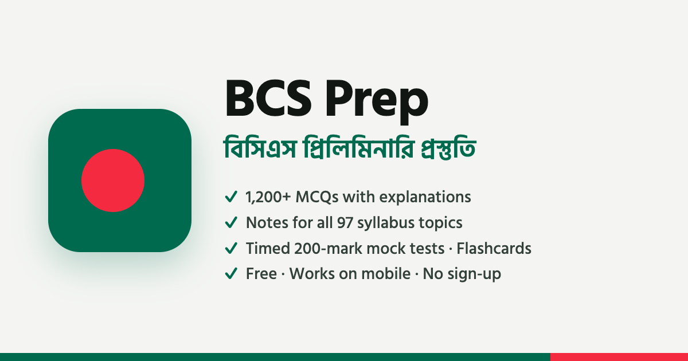

# BCS Prep: Preliminary

**Free preparation for the BCS Preliminary Test** (Bangladesh Civil Service): 200 MCQs in 2 hours, with 0.50 marks deducted for each wrong answer.

### ▶ Open the site: **https://abirhasanpiash.github.io/bcs-prep/**

No sign-up and nothing to install. It works on phones, tablets and computers, in Bangla and English.



## What's inside

| Section | What it does |
|---|---|
| **Dashboard** | Countdown, today's goal, subject readiness, mock-score trend, study heatmap and weakest topics |
| **Exam guide** | How BCS works, the current rules and marks distribution, the maths of negative marking, time management |
| **Syllabus** | All 97 topics of the preliminary syllabus, each with a status you can track |
| **Study notes** | Exam-focused notes for every topic, plus a box for your own notes |
| **Practice** | Questions by subject or topic. *Learn* mode explains each answer; *Timed test* mode scores you with negative marking |
| **Mock tests** | Full (200 Qs, 2 h), half, quick and single-subject tests with an OMR answer sheet, a timer and a per-subject result |
| **Flashcards** | Spaced repetition: cards you know come back after 1, 3, 7, 15 and 30 days |
| **Review** | Questions you last got wrong, your bookmarks, and the ones you miss most |
| **Study planner** | Spreads the remaining topics over the days until your exam, with weekly mocks and a final revision phase |

Content: 1,200+ MCQs with explanations, notes for all 97 syllabus topics and 800+ flashcards, written to the current (50th BCS) marks distribution. **Current affairs are updated to 14 October 2026.**

## Using it on your phone

- Open the link in Chrome (Android) or Safari (iPhone).
- To get an app-like icon: Chrome menu **⋮ → Add to Home screen**, or Safari **Share → Add to Home Screen**.
- Your progress (answers, mock results, flashcards, notes, plan) is saved **only in that browser on that device**. Nothing is uploaded. To move to another device or browser, use **Settings → Export backup**, then **Import backup** on the other one.

## Found a mistake?

Every question and note has a **Report a mistake** link that opens a GitHub issue with the question already filled in. You can also [open an issue](https://github.com/AbirHasanPiash/bcs-prep/issues) directly. Please include a source if you can.

The questions and notes were written for this site to match the syllabus and the style of the exam. They are not copies of past papers. Time-sensitive facts show the date they were checked. **Always confirm exam rules and dates with the official circular at [bpsc.gov.bd](https://bpsc.gov.bd).**

## Exam facts used (checked October 2026)

- **Marks distribution (from the 50th BCS):** Bangla 30, English 30, Bangladesh Affairs 25, International Affairs 25, Geography/Environment/Disaster Management 10, General Science 15, Computer & IT 15, Mathematical Reasoning 20, Mental Ability 15, Ethics/Values/Good Governance 15.
- 2 hours, 200 marks, −0.50 per wrong answer.
- Age limit 21–32, with no limit on attempts. Viva is 100 marks (from the 47th BCS). Application fee Tk 200.
- The 51st BCS (circular 24 Sep 2026) is a special BCS for doctors, so the next **general** BCS is the 52nd. PSC plans its circular for around November 2026.

---

## For developers and contributors

The site is plain HTML, CSS and JavaScript with no build step and no dependencies. GitHub Pages serves the repository root as it is.

**Run it locally:** open `index.html` in a browser (it works straight from the folder), or serve the folder:

```bash
python3 -m http.server 8000   # then open http://localhost:8000
```

**Folder layout**

```
index.html              the app shell
manifest.webmanifest    home-screen name and icons
assets/css/app.css      styles (light and dark themes, phone layouts)
assets/js/              app code (plain JavaScript)
assets/icons/           icons and the link-preview image
data/syllabus.js        subjects, marks and the 97 topics
data/questions/*.js     MCQ bank, one file per subject
data/notes/*.js         study notes, one file per subject
data/flashcards/*.js    flashcards, one file per subject
docs/CONTENT_GUIDE.md   format and accuracy rules for content
tools/validate.js       checks every content file for mistakes
```

**Adding or fixing content**

1. Read `docs/CONTENT_GUIDE.md`.
2. Edit the subject's file in `data/questions/`, `data/notes/` or `data/flashcards/`. New items get new ids that continue the numbering. Never renumber or reuse an id: each user's progress is stored by id.
3. Check your work with [Node.js](https://nodejs.org):

   ```bash
   node tools/validate.js
   ```

   It must end with `0 error(s)`.

4. Open a pull request.

**Publishing an update:** every push to `main` goes live on GitHub Pages within a minute or two. Change the `?v=` date on the script and stylesheet tags in `index.html` at the same time, so returning visitors get the new files instead of cached ones.

Keyboard shortcuts on a computer: `1`–`4` answer · `Enter` next · `B` bookmark · `/` search · `Space` flips a flashcard.
